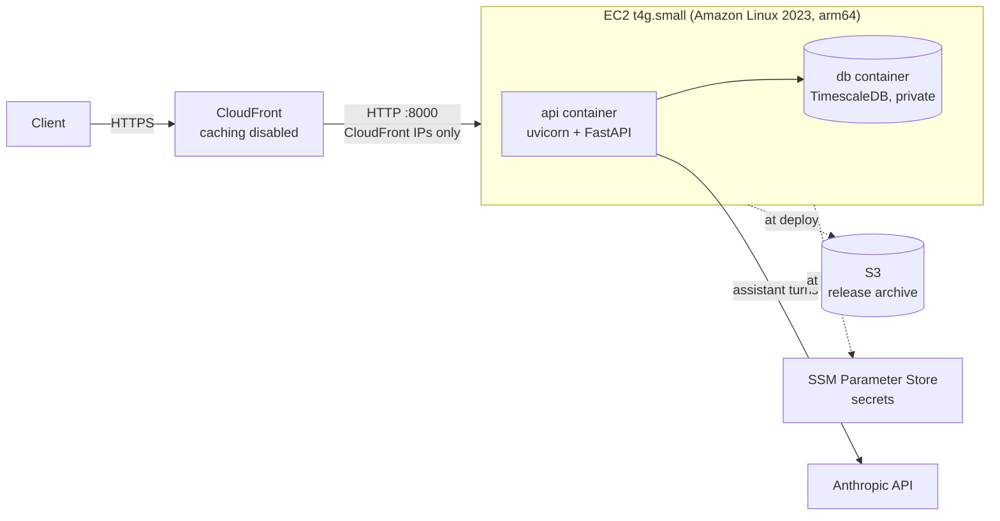

# Deployment

How the DataBull backend runs on AWS, how it was set up, how to ship a new release, and how to tear it all down.

The backend runs as the same Docker Compose stack used locally (TimescaleDB plus the FastAPI API) on a single EC2 instance, behind a CloudFront distribution that provides HTTPS. The frontend is hosted on Vercel and calls the CloudFront URL directly; see [Connecting the Vercel frontend](#connecting-the-vercel-frontend).

---

## Table of Contents

1. [Architecture](#architecture)
2. [Why this shape](#why-this-shape)
3. [Cost](#cost)
4. [Resources](#resources)
5. [How it was deployed](#how-it-was-deployed)
6. [Shipping a new release](#shipping-a-new-release)
7. [Connecting the Vercel frontend](#connecting-the-vercel-frontend)
8. [Operating the server](#operating-the-server)
9. [Security notes and known limitations](#security-notes-and-known-limitations)
10. [Troubleshooting](#troubleshooting)
11. [Teardown](#teardown)

---

## Architecture



| Layer | What it does |
|:------|:-------------|
| CloudFront | HTTPS endpoint (`https://<id>.cloudfront.net`). Caching is off, every header except `Host` is forwarded (including `Authorization`), all HTTP methods are allowed, and HTTP redirects to HTTPS. |
| Security group | Admits TCP 8000 only from CloudFront's managed origin-facing prefix list. No SSH, no Postgres. |
| EC2 | Runs `deploy/docker-compose.prod.yml`. Postgres is not published to the host; only the API container can reach it. |
| S3 | Holds the release archive the server downloads at deploy time. Private, encrypted, public access blocked. |
| SSM Parameter Store | Holds the JWT signing key, the database password, and the optional Anthropic key as `SecureString`s. |
| IAM role | Lets the server read only `releases/*` in the bucket and only `/databull/*` parameters, plus Session Manager access. |

## Why this shape

**TimescaleDB rules out a managed AWS database.** The `readings` table is a hypertable, and `GET /readings/aggregate` uses `time_bucket`. AWS's extension tables for RDS for PostgreSQL 16 and Aurora PostgreSQL 16 do not list `timescaledb` (nor do versions 17 to 19), so moving to RDS or Aurora would mean replacing the hypertable and `time_bucket` with plain PostgreSQL features. Running the existing stack on one instance keeps the code unchanged.

**The image builds on the server.** The server downloads the source from S3 and runs `docker compose up --build`, so releasing needs no local Docker and no container registry.

**Alternatives considered:**

| Option | Trade-off |
|:-------|:----------|
| ECS Fargate for the API, TimescaleDB on its own EC2 instance | More production-like, but adds a load balancer (the largest fixed cost) and a registry, and needs Docker locally or CodeBuild. |
| ECS Fargate with RDS PostgreSQL | Managed database, but TimescaleDB has to be removed from the code first. |
| CloudFront VPC origin with the instance in a private subnet | The more secure way to front EC2 (see [Security notes](#security-notes-and-known-limitations)), but a private instance needs a NAT gateway to pull Docker Hub images and release binaries, which would cost more than the rest of this stack combined. |

## Cost

Prices from the AWS Pricing API for `us-east-2`, assuming the server runs all 730 hours of a month:

| Resource | Rate | Monthly |
|:---------|:-----|:--------|
| EC2 `t4g.small` | $0.0168 / hour | $12.26 |
| EBS `gp3`, 20 GiB | $0.08 / GB-month | $1.60 |
| Elastic IP (public IPv4) | $0.005 / hour | $3.65 |
| CloudFront | Free tier covers demo traffic | ~$0 |
| S3 archive and SSM standard parameters | Standard parameters are free | < $0.01 |
| **Total** | | **≈ $17.51** |

Stopping the instance stops the $12.26 compute charge; the disk and Elastic IP keep billing (about $5.25 a month). Anthropic usage by the assistant is billed separately to the owner of the Anthropic key.

## Resources

All in `us-east-2` except CloudFront, which is global. Everything is tagged `project=databull`.

| Resource | Name | Notes |
|:---------|:-----|:------|
| S3 bucket | `databull-releases-<account-id>-us-east-2` | `releases/latest.tar.gz`; all four public-access blocks on; SSE-S3 encryption |
| SSM parameter | `/databull/release-bucket` | `String`: the bucket name |
| SSM parameter | `/databull/secret-key` | `SecureString`: signs JWTs (32 random bytes, URL-safe) |
| SSM parameter | `/databull/db-password` | `SecureString`: Postgres password (32 random bytes, hex) |
| SSM parameter | `/databull/anthropic-api-key` | `SecureString`, optional: enables `/chat/stream` |
| SSM parameter | `/databull/cors-allow-origins` | `String`, optional: comma-separated browser origins allowed to call the API (the Vercel frontend) |
| IAM role | `databull-ec2-role` | `AmazonSSMManagedInstanceCore` + inline `databull-read-releases-and-params` |
| Instance profile | `databull-ec2-profile` | Wraps the role |
| Security group | `databull-api-sg` | Inbound TCP 8000 from `com.amazonaws.global.cloudfront.origin-facing` only |
| EC2 instance | tag `Name=databull-api` | `t4g.small`, Amazon Linux 2023 arm64, 20 GiB encrypted gp3, IMDSv2 required with hop limit 1 |
| Elastic IP | tag `Name=databull-api` | Keeps the origin hostname stable across stops and starts |
| CloudFront distribution | comment `DataBull API ...` | Origin is the Elastic IP's public DNS name on port 8000 |

Repository files:

| File | Purpose |
|:-----|:--------|
| `deploy/docker-compose.prod.yml` | Production stack: private database, secrets from the environment, no `--reload`, automatic restarts |
| `deploy/bootstrap.sh` | Server-side install and deploy script. Runs as EC2 user data on first boot and through SSM Run Command on each release. Safe to repeat. |
| `deploy/release.sh` | Local script that packages, uploads, and triggers a redeploy |

## How it was deployed

Every command below runs from the repository root. These variables are used throughout:

```bash
export AWS_PROFILE=databull AWS_REGION=us-east-2
ACCOUNT_ID=$(aws sts get-caller-identity --query Account --output text)
BUCKET="databull-releases-${ACCOUNT_ID}-us-east-2"
VPC_ID=$(aws ec2 describe-vpcs --filters Name=is-default,Values=true --query 'Vpcs[0].VpcId' --output text)
```

### 1. Sign in and check the plan

```bash
aws login --region us-east-2 --profile databull
aws freetier get-account-plan-state
```

Credentials last 12 hours; when a command reports an expired session, run `aws login` again. On the free plan, EC2 is limited to free-plan-eligible instance types:

```bash
aws ec2 describe-instance-types --filters Name=free-tier-eligible,Values=true \
  --query 'InstanceTypes[].InstanceType' --output text
```

`t4g.small` (2 vCPU, 2 GiB) is eligible. `t4g.micro` is also eligible, but 1 GiB of memory is too tight for TimescaleDB plus the API.

### 2. Create the release bucket

```bash
aws s3api create-bucket --bucket "$BUCKET" \
  --create-bucket-configuration LocationConstraint=us-east-2
aws s3api put-public-access-block --bucket "$BUCKET" --public-access-block-configuration \
  BlockPublicAcls=true,IgnorePublicAcls=true,BlockPublicPolicy=true,RestrictPublicBuckets=true
aws s3api put-bucket-tagging --bucket "$BUCKET" --tagging 'TagSet=[{Key=project,Value=databull}]'
```

The first release is uploaded by `deploy/release.sh`, or by hand as in [Shipping a new release](#shipping-a-new-release).

### 3. Store the secrets

The bucket name is not secret:

```bash
aws ssm put-parameter --name /databull/release-bucket --type String --value "$BUCKET" \
  --tags Key=project,Value=databull
```

The two generated secrets are written through a temporary file that only you can read, so the values never appear on screen, in shell history, or in the process list. (The AWS CLI does not read `--cli-input-json` from a pipe, which is why this uses a file.)

```bash
for spec in secret-key:urlsafe db-password:hex; do
  name="${spec%%:*}"; kind="${spec##*:}"; f=$(mktemp)
  python3 -c "
import json, secrets, sys
v = secrets.token_urlsafe(32) if sys.argv[2] == 'urlsafe' else secrets.token_hex(32)
json.dump({'Name': '/databull/' + sys.argv[1], 'Type': 'SecureString', 'Value': v,
           'Tags': [{'Key': 'project', 'Value': 'databull'}]}, open(sys.argv[3], 'w'))
" "$name" "$kind" "$f"
  aws ssm put-parameter --cli-input-json "file://$f" --query Version --output text
  rm -f "$f"
done
```

The Anthropic key is optional. Without it, `POST /chat/stream` returns `503 assistant_unavailable` and everything else works. To add it (this prompts without echoing):

```bash
read -rs "K?Anthropic API key: " && echo && f=$(mktemp) && printf '{"Name":"/databull/anthropic-api-key","Type":"SecureString","Value":"%s"}' "$K" > "$f" && aws ssm put-parameter --cli-input-json "file://$f" --query Version --output text; rm -f "$f"; unset K
```

That is zsh syntax; in bash, use `read -rsp "Anthropic API key: " K`. A key added after the server is running takes effect on the next release.

### 4. Create the server's IAM role

```bash
aws iam create-role --role-name databull-ec2-role --tags Key=project,Value=databull \
  --assume-role-policy-document '{"Version":"2012-10-17","Statement":[{"Effect":"Allow","Principal":{"Service":"ec2.amazonaws.com"},"Action":"sts:AssumeRole"}]}'

aws iam attach-role-policy --role-name databull-ec2-role \
  --policy-arn arn:aws:iam::aws:policy/AmazonSSMManagedInstanceCore

aws iam put-role-policy --role-name databull-ec2-role --policy-name databull-read-releases-and-params \
  --policy-document "{\"Version\":\"2012-10-17\",\"Statement\":[
    {\"Effect\":\"Allow\",\"Action\":\"s3:GetObject\",\"Resource\":\"arn:aws:s3:::${BUCKET}/releases/*\"},
    {\"Effect\":\"Allow\",\"Action\":\"ssm:GetParameter\",\"Resource\":\"arn:aws:ssm:us-east-2:${ACCOUNT_ID}:parameter/databull/*\"}]}"

aws iam create-instance-profile --instance-profile-name databull-ec2-profile --tags Key=project,Value=databull
aws iam add-role-to-instance-profile --instance-profile-name databull-ec2-profile --role-name databull-ec2-role
```

The inline policy is deliberately narrow: no bucket listing, no writes, and only the `/databull/` parameters. The `SecureString`s use the AWS-managed `aws/ssm` key, which needs no separate KMS permission.

### 5. Create the security group

```bash
PL=$(aws ec2 describe-managed-prefix-lists \
  --filters Name=prefix-list-name,Values=com.amazonaws.global.cloudfront.origin-facing \
  --query 'PrefixLists[0].PrefixListId' --output text)

SG=$(aws ec2 create-security-group --group-name databull-api-sg \
  --description "DataBull API: port 8000 from CloudFront only" --vpc-id "$VPC_ID" \
  --tag-specifications 'ResourceType=security-group,Tags=[{Key=project,Value=databull},{Key=Name,Value=databull-api-sg}]' \
  --query GroupId --output text)

aws ec2 authorize-security-group-ingress --group-id "$SG" \
  --ip-permissions "IpProtocol=tcp,FromPort=8000,ToPort=8000,PrefixListIds=[{PrefixListId=$PL,Description=CloudFront origin-facing}]"
```

### 6. Launch the server and attach an Elastic IP

```bash
AMI=$(aws ssm get-parameter --name /aws/service/ami-amazon-linux-latest/al2023-ami-kernel-default-arm64 \
  --query Parameter.Value --output text)
SUBNET=$(aws ec2 describe-subnets --filters Name=vpc-id,Values="$VPC_ID" Name=default-for-az,Values=true \
  --query 'sort_by(Subnets,&AvailabilityZone)[0].SubnetId' --output text)

IID=$(aws ec2 run-instances --image-id "$AMI" --instance-type t4g.small --count 1 \
  --subnet-id "$SUBNET" --security-group-ids "$SG" \
  --iam-instance-profile Name=databull-ec2-profile \
  --user-data file://deploy/bootstrap.sh \
  --metadata-options HttpTokens=required,HttpPutResponseHopLimit=1,HttpEndpoint=enabled \
  --block-device-mappings 'DeviceName=/dev/xvda,Ebs={VolumeSize=20,VolumeType=gp3,Encrypted=true,DeleteOnTermination=true}' \
  --tag-specifications 'ResourceType=instance,Tags=[{Key=Name,Value=databull-api},{Key=project,Value=databull}]' 'ResourceType=volume,Tags=[{Key=project,Value=databull}]' \
  --query 'Instances[0].InstanceId' --output text)
aws ec2 wait instance-running --instance-ids "$IID"

ALLOC=$(aws ec2 allocate-address --domain vpc \
  --tag-specifications 'ResourceType=elastic-ip,Tags=[{Key=project,Value=databull},{Key=Name,Value=databull-api}]' \
  --query AllocationId --output text)
aws ec2 associate-address --instance-id "$IID" --allocation-id "$ALLOC"
```

Choices worth knowing:

- **IMDSv2 required, hop limit 1.** The instance metadata service (where the server's role credentials come from) only answers the host itself. Containers cannot reach it, so a compromised container cannot take the role's credentials.
- **20 GiB disk.** The image default of 8 GiB fills up once Docker images and the database grow.
- **Elastic IP.** Without it the public address and hostname change on every stop and start, which would break the CloudFront origin.

On first boot, `bootstrap.sh` installs Docker, the Compose and buildx plugins (pinned versions with pinned SHA-256 checksums), downloads the release from S3, writes the secrets to a root-only env file, and runs `docker compose up --build`. It logs to `/var/log/databull-bootstrap.log`.

### 7. Create the CloudFront distribution

```bash
ORIGIN=$(aws ec2 describe-instances --instance-ids "$IID" \
  --query 'Reservations[0].Instances[0].PublicDnsName' --output text)

cat > /tmp/databull-cf.json <<JSON
{"DistributionConfig":{
  "CallerReference":"databull-api-$(date +%s)",
  "Comment":"DataBull API (HTTPS front door for the EC2 origin)",
  "Enabled":true, "IsIPV6Enabled":true, "PriceClass":"PriceClass_100", "HttpVersion":"http2",
  "Origins":{"Quantity":1,"Items":[{
    "Id":"databull-ec2","DomainName":"$ORIGIN",
    "CustomOriginConfig":{"HTTPPort":8000,"HTTPSPort":443,"OriginProtocolPolicy":"http-only",
      "OriginSslProtocols":{"Quantity":1,"Items":["TLSv1.2"]},
      "OriginReadTimeout":60,"OriginKeepaliveTimeout":5}}]},
  "DefaultCacheBehavior":{
    "TargetOriginId":"databull-ec2","ViewerProtocolPolicy":"redirect-to-https",
    "AllowedMethods":{"Quantity":7,"Items":["GET","HEAD","OPTIONS","PUT","POST","PATCH","DELETE"],
      "CachedMethods":{"Quantity":2,"Items":["GET","HEAD"]}},
    "CachePolicyId":"4135ea2d-6df8-44a3-9df3-4b5a84be39ad",
    "OriginRequestPolicyId":"b689b0a8-53d0-40ab-baf2-68738e2966ac",
    "Compress":false}},
 "Tags":{"Items":[{"Key":"project","Value":"databull"}]}}
JSON
aws cloudfront create-distribution-with-tags \
  --distribution-config-with-tags file:///tmp/databull-cf.json \
  --query 'Distribution.[Id,DomainName]' --output text
```

| Setting | Why |
|:--------|:----|
| `Managed-CachingDisabled` (`4135ea2d-...`) | Responses carry per-user data and must never be cached and served to someone else. |
| `Managed-AllViewerExceptHostHeader` (`b689b0a8-...`) | CloudFront strips `Authorization` by default; this policy forwards every viewer header except `Host`, so bearer tokens and query strings reach the API. |
| All seven HTTP methods | The API uses POST, PATCH, and DELETE. |
| `OriginReadTimeout` 60 | CloudFront's maximum without a quota increase, and equal to the API's 60-second assistant turn limit. |
| `PriceClass_100` | North America and Europe edges; the cheapest class. |

The distribution takes a few minutes to reach `Deployed`.

### 8. Verify

```bash
U=https://$(aws cloudfront list-distributions \
  --query "DistributionList.Items[?starts_with(Comment,'DataBull API')].DomainName | [0]" --output text)

curl -s "$U/health"                                                   # {"status":"ok"}
curl -s -o /dev/null -w "%{http_code}\n" "${U/https/http}/health"    # 301 (redirects to HTTPS)
curl -s "$U/auth/me"                                                  # code: not_authenticated
curl -s -H "Authorization: Bearer not-a-real-token" "$U/auth/me"      # code: invalid_token
curl -s -D - -o /dev/null "$U/health" | grep -i x-cache              # Miss from cloudfront, every time
curl -s -m 8 "http://$(aws ec2 describe-addresses --filters Name=tag:Name,Values=databull-api --query 'Addresses[0].PublicIp' --output text):8000/health" || echo "origin blocked"
```

The fake-token check proves CloudFront forwards `Authorization` without creating an account: with the header missing, the API answers `not_authenticated`; with an invalid token, it answers `invalid_token`. Getting `invalid_token` means the header arrived.

To check the assistant's streaming end to end, sign up and stream one turn. `-N` turns off curl's buffering so frames print as they arrive:

```bash
TOKEN=$(curl -s -X POST "$U/auth/signup" -H 'Content-Type: application/json' \
  -d '{"email":"you@example.com","password":"choose-a-long-password"}' \
  | python3 -c 'import json,sys; print(json.load(sys.stdin)["access_token"])')

curl -N -X POST "$U/chat/stream" -H "Authorization: Bearer $TOKEN" \
  -H 'Content-Type: application/json' \
  -d '{"messages":[{"role":"user","content":"What devices do I have?"}]}'
```

Without an Anthropic key in SSM, that request returns `503 assistant_unavailable` instead of a stream.

## Shipping a new release

Commit your changes, then:

```bash
AWS_PROFILE=databull deploy/release.sh
```

It packages the committed `HEAD` with `git archive`, uploads it to `s3://<bucket>/releases/latest.tar.gz`, and runs this on the server through SSM Run Command:

```bash
B=$(aws ssm get-parameter --region us-east-2 --name /databull/release-bucket --query Parameter.Value --output text)
aws s3 cp --region us-east-2 s3://$B/releases/latest.tar.gz - | tar -xzO deploy/bootstrap.sh > /tmp/databull-bootstrap.sh
bash /tmp/databull-bootstrap.sh
```

The server always runs the `bootstrap.sh` that shipped with the release. Each release is extracted to a new directory under `/opt/databull/releases/` (the newest two are kept), and the fixed Compose project name keeps the database volume, `databull_db_data`, across releases. Migrations run automatically when the API container starts.

Only committed code ships. Uncommitted changes outside `deploy/` are left out, and the script says so.

## Connecting the Vercel frontend

The frontend is a static Vite build on Vercel, so it has no server of its own to forward `/api` the way the local dev server does. Instead the browser calls the API's CloudFront URL directly, which takes three pieces.

**1. Tell the frontend where the API is.** In the Vercel project, set `VITE_API_BASE_URL` to the CloudFront URL for both Production and Preview, then redeploy. Vite inlines the value when it builds, so changing it always needs a new build.

```bash
cd frontend
vercel env add VITE_API_BASE_URL production     # paste https://<id>.cloudfront.net
vercel env add VITE_API_BASE_URL preview
vercel --prod
```

**2. Allow the frontend's origin in the API.** Browsers block a page from reading another origin's responses unless that origin opts in with CORS headers. The allowlist is the `/databull/cors-allow-origins` parameter, holding every stable production URL of the Vercel project:

```bash
aws ssm put-parameter --name /databull/cors-allow-origins --type String --overwrite \
  --value "https://<project>.vercel.app,https://<project>-<team>.vercel.app"
AWS_PROFILE=databull deploy/release.sh
```

Origins must match exactly, with no trailing slash. Vercel preview deployments get their own URLs, so they are not covered by these entries; add a preview URL here to test against it. The bootstrap script reads the parameter on each release, so a change needs a release to take effect.

**3. Serve the app for client-side routes.** `frontend/vercel.json` rewrites any path that is not a real file to `index.html`, so React Router handles a reload on `/devices` instead of Vercel returning a 404. Vercel serves real files (scripts, styles, images) before applying rewrites.

**No CloudFront change is needed.** The distribution already forwards every viewer header except `Host` (including `Origin` and the preflight `Access-Control-Request-*` headers), allows `OPTIONS`, and disables caching, so a CORS response for one origin is never served to another.

**Why not proxy `/api` through a Vercel rewrite instead?** A rewrite would keep the browser on one origin and avoid CORS, but Vercel's documentation does not say whether proxied requests keep the `Authorization` header or whether streaming responses are buffered, and it caps proxied requests at 120 seconds. Calling CloudFront directly relies only on behavior verified above.

The CORS setup allows the methods the API uses and only the `Authorization` and `Content-Type` request headers. Credentials mode stays off, because the token travels in a header and the app never uses cookies. Error responses, including the `401` that signs a user out, carry the CORS headers too, so the page can read them.

## Operating the server

There is no SSH. Use Session Manager for a shell (requires the [Session Manager plugin](https://docs.aws.amazon.com/systems-manager/latest/userguide/session-manager-working-with-install-plugin.html) for the AWS CLI):

```bash
IID=$(aws ec2 describe-instances --filters Name=tag:Name,Values=databull-api Name=instance-state-name,Values=running \
  --query 'Reservations[0].Instances[0].InstanceId' --output text)
aws ssm start-session --target "$IID"
```

On the server, as root (`sudo -i`):

```bash
tail -f /var/log/databull-bootstrap.log                       # deploy log
cd "$(ls -1dt /opt/databull/releases/* | head -1)/deploy"
docker compose -f docker-compose.prod.yml --env-file /opt/databull/.env ps
docker compose -f docker-compose.prod.yml --env-file /opt/databull/.env logs -f api
```

To pause compute charges, stop the instance; both containers start again on boot. The Elastic IP keeps the CloudFront origin valid across the restart.

```bash
aws ec2 stop-instances --instance-ids "$IID"
aws ec2 start-instances --instance-ids "$IID"
```

## Security notes and known limitations

**Only the first hop is encrypted.** Client to CloudFront is HTTPS, but CloudFront to the server is plain HTTP over the public internet. The server's AWS-assigned hostname cannot carry a TLS certificate. Treat this as fine for a demo, not for real user data. The fixes, from the CloudFront origin-protection guidance:

- **VPC origin** (recommended): move the instance to a private subnet and make it a CloudFront VPC origin, so that hop never touches the public internet and the instance has no public IP. The cost is outbound internet for the private instance (a NAT gateway).
- **A custom domain with TLS on the origin**, or origin mutual TLS, for an origin that stays public.

**The security group stops direct access but does not prove the request came from this distribution.** CloudFront's managed prefix list covers every CloudFront distribution, not just this one. A VPC origin or origin mutual TLS closes that gap.

**Anyone can sign up.** The API is public and signup is open, so if an Anthropic key is configured, anyone with an account can run assistant turns billed to that key. Set a spend limit on the key in the Anthropic console, or leave the key out.

**No database backups are configured.** The data lives on the instance's EBS volume, which is deleted if the instance is terminated. For data worth keeping, schedule EBS snapshots with Amazon Data Lifecycle Manager or AWS Backup, or run `pg_dump` to S3.

**Secrets on the server.** The bootstrap writes secrets to `/opt/databull/.env` (mode 600, root only), and Docker keeps them in the containers' configuration, which root can read. Anyone with root on the instance can read them, as on any single-host deployment.

**Single instance.** No redundancy: a stopped or failed instance means downtime, and a release restarts the API container.

**The TimescaleDB image tag is not pinned.** `timescale/timescaledb:latest-pg16` matches local development. Pinning a specific version would make database upgrades deliberate rather than happening on a fresh pull.

**IAM is scoped narrowly.** The instance role can read only `releases/*` in the release bucket and only `/databull/*` parameters. It cannot list the bucket or write anything.

## Troubleshooting

**`Your session has expired. Please reauthenticate using 'aws login'`.** Credentials last 12 hours. Run `aws login --profile databull`.

**`compose build requires buildx 0.17.0 or later`.** The Amazon Linux 2023 `docker` package ships an older buildx than Compose requires. `bootstrap.sh` installs a pinned buildx into `/usr/local/lib/docker/cli-plugins/`, which takes precedence over the system copy.

**`Error parsing parameter 'cli-input-json': Invalid JSON received`.** The AWS CLI does not read `--cli-input-json` from a pipe such as `file:///dev/stdin`. Write the JSON to a `mktemp` file and pass `file://<path>`.

**`tar: Ignoring unknown extended header keyword 'LIBARCHIVE.xattr...'`.** Harmless. macOS `tar` adds Apple file metadata that Linux `tar` ignores. `release.sh` packages with `--no-mac-metadata --no-xattrs` to avoid it.

**CloudFront returns 502 or 504.** The API is not answering on port 8000. Check the bootstrap log and `docker compose ps` over Session Manager. If the instance was stopped and started without the Elastic IP attached, the origin hostname will be stale.

**The tools work but `/chat/stream` returns 503.** No Anthropic key is stored, or it was added after the last release. Add it to `/databull/anthropic-api-key` and run `deploy/release.sh`.

**The browser reports a CORS error, or every request from the frontend fails with a network error.** The page's origin is not in the allowlist, or the allowlist was changed after the last release. The origin must match exactly: scheme, host, and no trailing slash. Check `/databull/cors-allow-origins`, then run `deploy/release.sh`. Vercel preview deployments have their own URLs and are not covered by the production entries.

**The frontend calls `/api/...` on the Vercel domain and gets 404s.** It was built without `VITE_API_BASE_URL`. Set the variable in Vercel and redeploy the frontend; Vite reads it at build time, so a running deployment never picks it up.

## Teardown

Removes every resource above. **This deletes the database and cannot be undone.** Order matters: CloudFront must be disabled before it can be deleted, and the security group can only be deleted after the instance is gone.

```bash
export AWS_PROFILE=databull AWS_REGION=us-east-2
ACCOUNT_ID=$(aws sts get-caller-identity --query Account --output text)
BUCKET="databull-releases-${ACCOUNT_ID}-us-east-2"

# 1. CloudFront: disable, wait for the change to deploy, then delete
DIST=$(aws cloudfront list-distributions --query "DistributionList.Items[?starts_with(Comment,'DataBull API')].Id | [0]" --output text)
aws cloudfront get-distribution-config --id "$DIST" > /tmp/cf.json
ETAG=$(python3 -c 'import json; print(json.load(open("/tmp/cf.json"))["ETag"])')
python3 -c 'import json; d=json.load(open("/tmp/cf.json"))["DistributionConfig"]; d["Enabled"]=False; json.dump(d, open("/tmp/cf-off.json","w"))'
aws cloudfront update-distribution --id "$DIST" --if-match "$ETAG" --distribution-config file:///tmp/cf-off.json >/dev/null
aws cloudfront wait distribution-deployed --id "$DIST"
aws cloudfront delete-distribution --id "$DIST" --if-match "$(aws cloudfront get-distribution --id "$DIST" --query ETag --output text)"

# 2. EC2 instance (its encrypted root volume is deleted with it) and the Elastic IP
IID=$(aws ec2 describe-instances --filters Name=tag:Name,Values=databull-api Name=instance-state-name,Values=pending,running,stopping,stopped --query 'Reservations[0].Instances[0].InstanceId' --output text)
aws ec2 terminate-instances --instance-ids "$IID" >/dev/null
aws ec2 wait instance-terminated --instance-ids "$IID"
aws ec2 release-address --allocation-id "$(aws ec2 describe-addresses --filters Name=tag:Name,Values=databull-api --query 'Addresses[0].AllocationId' --output text)"

# 3. Security group
aws ec2 delete-security-group --group-id "$(aws ec2 describe-security-groups --filters Name=group-name,Values=databull-api-sg --query 'SecurityGroups[0].GroupId' --output text)"

# 4. IAM
aws iam remove-role-from-instance-profile --instance-profile-name databull-ec2-profile --role-name databull-ec2-role
aws iam delete-instance-profile --instance-profile-name databull-ec2-profile
aws iam detach-role-policy --role-name databull-ec2-role --policy-arn arn:aws:iam::aws:policy/AmazonSSMManagedInstanceCore
aws iam delete-role-policy --role-name databull-ec2-role --policy-name databull-read-releases-and-params
aws iam delete-role --role-name databull-ec2-role

# 5. SSM parameters (the Anthropic key may not exist; that is fine)
aws ssm delete-parameters --names /databull/release-bucket /databull/secret-key /databull/db-password /databull/anthropic-api-key /databull/cors-allow-origins

# 6. S3 bucket
aws s3 rm "s3://$BUCKET" --recursive
aws s3api delete-bucket --bucket "$BUCKET"
```
