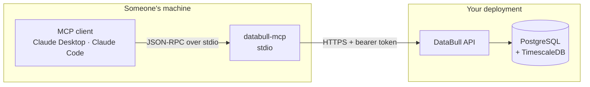

# MCP Server

DataBull's telemetry tools, published as an [MCP](https://modelcontextprotocol.io) server so any MCP client — Claude Desktop, Claude Code, or an agent you write yourself — can query a sensor fleet directly.

Four read-only tools: `list_devices`, `query_readings`, `aggregate_window`, `get_recent_alerts`. They are the same handlers the in-app assistant uses, so a fix to one benefits both.

---

## Table of Contents

1. [How it fits together](#how-it-fits-together)
2. [Setup](#setup)
3. [Connecting a client](#connecting-a-client)
4. [Configuration](#configuration)
5. [Tools](#tools)
6. [Security](#security)
7. [Troubleshooting](#troubleshooting)
8. [Development](#development)

---

## How it fits together

The MCP server is a **client of the DataBull API**, not a second consumer of the database. It holds your account credentials, calls the same HTTP endpoints the web app calls, and translates the results into MCP tool responses.



That boundary is the point. The API already enforces ownership twice and answers `404` rather than `403` for another tenant's rows, so going over HTTP inherits all of it; no database credentials ever leave your deployment; and it is the only arrangement in which someone else can run this server, because they have an account, not a database.

Internally the server supplies `Http{Device,Reading,Alert}Repository` — implementations of the same Protocols `app/agent/services.py` declares — so `app/agent/tools.py` and `tool_schemas.py` are imported unchanged. See SPEC § Extraction path, which named these three classes before this server existed.

---

## Setup

### Prerequisites

- A reachable DataBull API and an account on it
- Python 3.12+

### Install

```bash
cd backend
pip install -e ".[mcp]"
```

This registers the `databull-mcp` command. Note the absolute path to it — an MCP client launches the server without your virtualenv activated:

```bash
which databull-mcp
# /path/to/DataBull/backend/.venv/bin/databull-mcp
```

### Verify before wiring anything up

```bash
DATABULL_API_URL=http://localhost:8000 \
DATABULL_EMAIL=operator@example.com \
DATABULL_PASSWORD=... \
databull-mcp --check
```

A healthy run prints the API URL, which credential type is in use, your user id, and your actual device list, then exits `0`:

```
api        http://localhost:8000
credential email + password
user id    3f1b9c54-0b3e-4a2d-9f77-2c5a1d8e4b10
devices    [{"device_id":"...","name":"Pump-3","type":"pressure",...}]

OK — the server can reach the API and read your fleet.
```

A failure exits `1` and says why.

**Do not skip this step.** A misconfigured stdio server fails *silently* inside the host application — the tools simply do not appear, with no error surfaced anywhere you can see. `list_tools` is answered from the registered tools alone and never touches the API, so a server with entirely wrong credentials still looks healthy right up to the first tool call.

---

## Connecting a client

### Claude Code

```bash
claude mcp add databull -- /absolute/path/to/backend/.venv/bin/databull-mcp
```

Then add the environment variables to the generated entry in `.mcp.json`.

### Claude Desktop

Edit `claude_desktop_config.json` (macOS: `~/Library/Application Support/Claude/`):

```json
{
  "mcpServers": {
    "databull": {
      "command": "/absolute/path/to/backend/.venv/bin/databull-mcp",
      "env": {
        "DATABULL_API_URL": "http://localhost:8000",
        "DATABULL_EMAIL": "operator@example.com",
        "DATABULL_PASSWORD": "..."
      }
    }
  }
}
```

Restart the client. Four tools should appear under `databull`.

### Anything else

The server speaks standard MCP over stdio. Launch `databull-mcp` as a subprocess with the environment set and speak JSON-RPC to its stdin/stdout.

---

## Configuration

Read from the **environment only**. Unlike the API, this process does not read a `.env` file: an MCP client launches it from whatever directory the client happens to be in, so a relative path is not something to depend on. Pass configuration through the client's `env` block, or export it before `--check`.

| Variable | Required | Default | Description |
|:---------|:---------|:--------|:------------|
| `DATABULL_API_URL` | No | `http://localhost:8000` | Base URL of the DataBull API |
| `DATABULL_EMAIL` | One of | — | Account email; pairs with `DATABULL_PASSWORD` |
| `DATABULL_PASSWORD` | One of | — | Account password |
| `DATABULL_TOKEN` | One of | — | An existing access token, instead of email + password |
| `DATABULL_TIMEOUT_SECONDS` | No | `15` | Per-request timeout to the API |
| `MCP_TOOL_RESULT_MAX_BYTES` | No | `65536` | Cap on a tool's serialized result |

### Password or token?

They are **not** equivalent, and the difference matters for a long-running server:

- **email + password** — the server can mint its own token and re-mint it when one expires, so it survives unattended for as long as the client keeps it alive.
- **token** — scoped to its 24-hour life and **cannot be renewed**, because the API issues no refresh tokens (a documented v1 limitation). When it expires, tool calls fail with a message saying exactly that, and the server must be restarted with fresh credentials.

Use a password for a server you leave running; use a token when you would rather the credential in a config file expire on its own.

### Result size

`MCP_TOOL_RESULT_MAX_BYTES` defaults far above the chat endpoint's 2KB. That cap exists because those bytes are billed as Anthropic input tokens on every turn of the in-app assistant; an MCP client manages its own context window and would rather receive the full result set. Still bounded, so a thousand-row reply cannot be unbounded.

---

## Tools

All read-only. Every tool is scoped to the account the credentials belong to.

| Tool | Arguments | Returns |
|:-----|:----------|:--------|
| `list_devices` | none | Every device with its type, unit, and thresholds |
| `query_readings` | `device_id`, `start`, `end`, `limit` (≤1000) | Raw readings, newest first |
| `aggregate_window` | `device_id`, `window` (`1h`/`1d`/`1w`), `fn` (`avg`/`min`/`max`/`p95`), `start`, `end` | Bucketed rollups |
| `get_recent_alerts` | `since`, optional `device_id` | Threshold breaches |

`list_devices` comes first in practice: the other three take a `device_id` UUID, and it is the only place to obtain one. The tool descriptions say so, and they are the same descriptions the in-app assistant sees — they are prompt text, and the steering is as useful to your client's model as to ours.

Timestamps are ISO 8601 UTC. Time windows are half-open: `start` inclusive, `end` exclusive.

### Why writes are not exposed

Device creation, ingest, and deletion are deliberately absent. These tools are invoked by a model on someone's behalf, and an accidental `DELETE /readings` is not recoverable. If writes are ever added they go behind an explicit opt-in flag, not on by default.

---

## Security

**Credentials live in the client's config file.** Treat `claude_desktop_config.json` as a secret-bearing file. The server never logs the token or the password.

**stdout belongs to the protocol.** Under stdio the JSON-RPC stream *is* the process's stdout, so every diagnostic goes to stderr. A stray `print` would corrupt the session.

**Ownership is checked twice.** The API is the authority and enforces it, but the repositories also capture the authenticated identity once and re-check every `user_id` handed to them — the same belt-and-braces the in-process repositories apply. A mismatch raises rather than quietly querying as the wrong user.

---

## Troubleshooting

**The tools do not appear in the client.** The server failed to start. Check the client's MCP logs, then run `databull-mcp --check` with the same environment. The usual cause is a relative path in `command` — the client does not have your virtualenv activated.

**Tools appear but every call fails.** Credentials are wrong or the API is unreachable. `list_tools` never touches the API, which is why the tools show up anyway. `--check` will say which.

**"The access token is no longer valid … cannot be renewed."** The server was started with `DATABULL_TOKEN` and it expired. Restart with a fresh token, or switch to `DATABULL_EMAIL` + `DATABULL_PASSWORD` so it can re-mint one.

**`databull-mcp: command not found`.** The `mcp` extra was not installed: `pip install -e ".[mcp]"`.

---

## Development

```bash
cd backend

# Repositories against the real app in-process (via httpx ASGITransport)
pytest tests/test_mcp_repositories.py

# The published tool surface and dispatch
pytest tests/test_mcp_server.py

# A real stdio handshake against a spawned server — needs no API, no credentials
pytest tests/test_mcp_stdio.py
```

The repository tests run every request through the actual FastAPI application over `httpx.ASGITransport`, backed by the testcontainers Postgres. Nothing is mocked, which is the point: the enforcement this server relies on is the enforcement those tests exercise.

`tests/test_mcp_stdio.py` is the only test covering the transport itself — spawning the process, negotiating `initialize`, and reading the tool list back over JSON-RPC. It launches the server as `python -m app.mcp.server` so it does not depend on the console script being on `PATH`.

### Boundary rule

SPEC § Boundary rules, rule 7: `/mcp/` may import `/agent/` and `/schemas/`, and must never import `/api/`, `/services/`, `/models/`, or `/db/`. It reaches data over HTTP, never in process.
